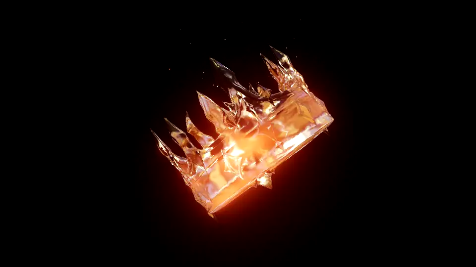

# A Crown of Ice and Fire

<a href="https://mikefernandez-pro.github.io/a-crown-of-ice-and-fire/"></a>

Molten gold sloshing inside a frosted ice crown, in the browser with WebGPU.

The gold is a Position-Based Fluid ([Three Blocks](https://threejs-blocks.com) `PBF`) held in a thin cavity inside the crown by a signed-distance-field constraint, drawn as one smooth surface with the Three Blocks screen-space water renderer. The ice is a `MeshTransmissionNodeMaterial` that refracts the gold and the backdrop behind it. The crown turns on its own; grab it to turn it yourself, throw it, and watch the gold follow.

## Run

```sh
npm install
npm run dev
```

Needs a browser with WebGPU (recent Chrome or Edge).

## Controls

- **Drag the crown** to turn it all the way round; let go mid-drag to throw it. It carries the throw for a moment, then picks up its own motion again.
- **Drag elsewhere** to orbit the camera; scroll to zoom.
- The panel tunes the ice, the gold, the backdrop, the crown's motion and the simulation. The bottom bar switches quality tiers (`?tier=baseline|high|medium|low`, `medium` by default) and turns individual systems off to see what each costs.

## Files

- `src/perf-prototype.js`: the scene `index.html` loads, with the quality tiers, timing overlay and tuning panels.
- `src/main.js`: the earlier single-tier version, kept for reference.
- `src/field.js`: the crown's signed distance field, computed on the GPU from the model as the page loads ([three-mesh-bvh](https://github.com/gkjohnson/three-mesh-bvh)'s compute traversals: a winding count for the sign, the closest point for the distance).
- `src/marching.js`, `src/rounding.js`: marching cubes over that field (the gold's cavity), and Taubin smoothing for rounding the ice.

## Credits

- Inspired by Yuri Artiukh's ([akella](https://github.com/akella)) [Gold in Glass](https://stream1018.vercel.app/gold.html) demo.
- Crown model created by me with [Tripo AI](https://www.tripo3d.ai).
- Fluid, SDF constraint, gold surface and ice material: [Three Blocks](https://threejs-blocks.com) (an npm dependency, under its own PolyForm Noncommercial licence: this project is non-commercial).
- Rendering: [three.js](https://threejs.org) `WebGPURenderer` and TSL.
- Environment maps from the three.js examples: `pedestrian_overpass`, `royal_esplanade` and `san_giuseppe_bridge` are from [Poly Haven](https://polyhaven.com) (CC0); `lobe.hdr` also comes from the three.js examples.
- Favicon: [Monarque icônes créées par iconfield - Flaticon](https://www.flaticon.com/fr/icones-gratuites/monarque).
